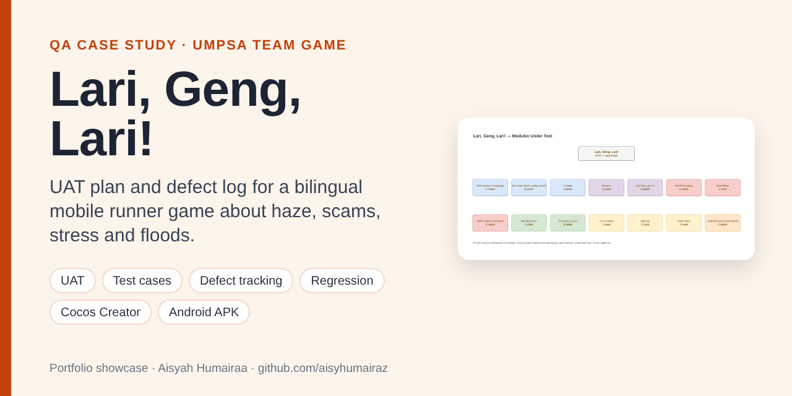
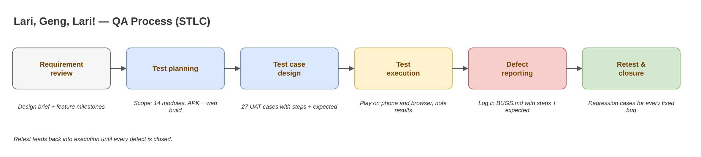
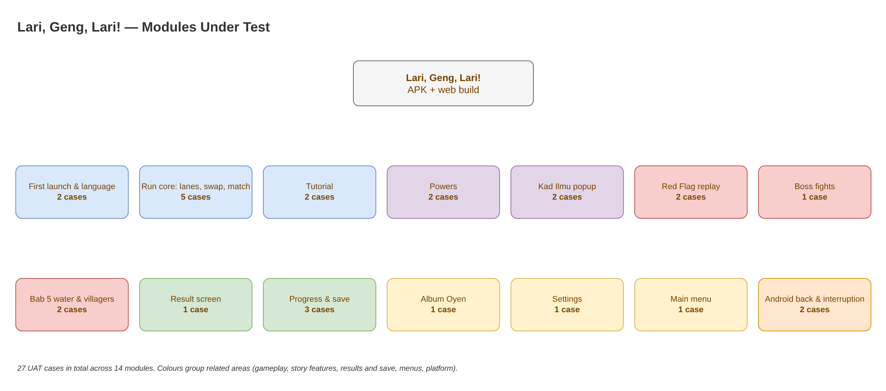
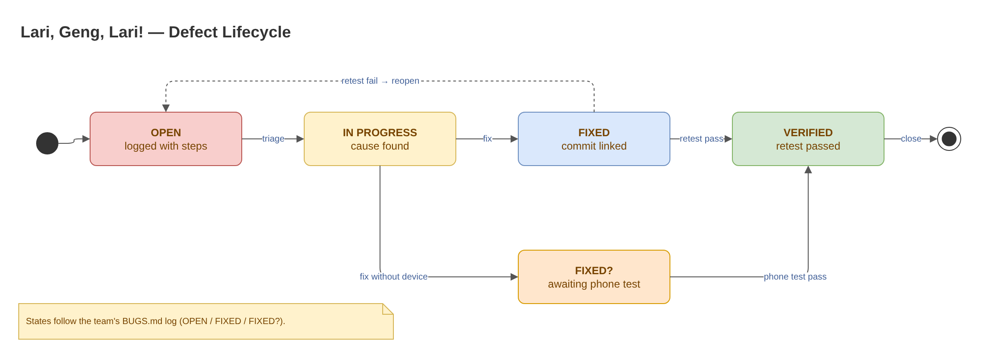

# Lari, Geng, Lari! — QA Case Study

> **Portfolio case study.** The game's source code belongs to the team and is private; a live walkthrough is available on request.

**Type:** Team project, Team CUKRUDEV BOBA, UMPSA  
**Role:** Idea contributor and QA (test planning, user acceptance testing, defect reporting)  
**Period:** October – November 2026  
**Product:** Bilingual (BM/EN) 2D mobile runner game built with Cocos Creator 3.8, shipped as an Android APK and a Huawei Quick Game build

## The game

Three housemates (Aiman, Mei and Kavitha) run through five chapters about real Malaysian problems: haze, online scams, online stress, exam stress and floods. Each friend beats one kind of threat, so the player swaps the leader to match what is coming. Along the way they collect *Kad Ilmu* fact cards, fight a boss at the end of a chapter and, in Bab 5, outrun rising flood water while rescuing villagers.

## QA scope

| Item | Detail |
|---|---|
| Test level | User acceptance testing (black-box, played like a real user) |
| Builds | Android APK on a phone, Cocos Web Mobile build in a browser |
| Modules | 14 (launch & language, run core, tutorial, powers, Kad Ilmu, Red Flag replay, bosses, Bab 5, result, progress & save, album, settings, menu, Android platform) |
| Test cases | 27, each with steps and an expected result |
| Regression | 8 cases re-check bugs from the team's defect log |

## QA process

## UAT test cases

Full sheet with columns for actual result, status, tester, date and device: [`docs/UAT_test_cases.csv`](docs/UAT_test_cases.csv) (opens in Excel).

| ID | Module | Test | Steps | Expected result | Status |
|---|---|---|---|---|---|
| UAT-01 | First launch | Language picker | Install the APK on a fresh phone and open it. | Language picker shows BM and EN; after choosing, splash then main menu appear. | Not run |
| UAT-02 | First launch | Language switch | Menu > Settings > change language BM to EN. | All menu text changes to English at once; no key names (e.g. 'menu.play') shown. | Not run |
| UAT-03 | Run core | Lane swipe | Start Bab 1. Swipe left and right (or press A/D). | The Geng moves one lane per swipe; never leaves the 3 lanes. | Not run |
| UAT-04 | Run core | Leader swap | During a run, tap the screen. | Leader rotates Aiman > Mei > Kavitha; HUD portrait updates. | Not run |
| UAT-05 | Run core | Right friend beats threat | Bab 1: put Mei in front and run into a smoke threat. | Threat is destroyed, score +100, combo grows; Semangat does not drop. | Not run |
| UAT-06 | Run core | Wrong friend gets hit | Bab 1: put Aiman in front and run into smoke. | Semangat drops; combo resets; Oyen tip appears on the first wrong hit. | Not run |
| UAT-07 | Run core | Teh tarik heals | Collect a teh tarik bag. | Semangat goes up and never above the maximum. | Not run |
| UAT-08 | Tutorial | Bab 1 tutorial | New save: play Bab 1. | Swipe prompt, then smoke in your lane with a hand hint until Mei leads; tutorial ends after the first match. | Not run |
| UAT-09 | Tutorial | Skip pill | Settings > Replay tutorial, then play Bab 1. | 'Langkau / Skip' pill shows its text and skips the tutorial (regression of BUG-009). | Not run |
| UAT-10 | Powers | Power ready | Make 5 right-friend matches. | Power meter fills; power button lights up; Oyen explains the power once. | Not run |
| UAT-11 | Powers | Use each power | Use Aiman, Mei and Kavitha powers when full. | Fact Check clears scams; Air Shield clears smoke + 3 s shield; Calm Mode slows the world and refills Semangat. | Not run |
| UAT-12 | Kad Ilmu | Card popup | Pick up a Kad Ilmu during a run. | Popup shows for about 2 s while the world slows; card is saved even if you quit the run. | Not run |
| UAT-13 | Kad Ilmu | Popup after losing | Pick up a card, then lose within 2 s. | Popup closes; it does not stay on the Result screen (regression of BUG-001). | Not run |
| UAT-14 | Red Flag | Ulang Tayang replay | Bab 2: hit a scam with the wrong friend. | Short freeze, slow-motion replay with a red-flag label and Aiman's line; tap skips the slow part. | Not run |
| UAT-15 | Red Flag | Tap grace after resume | Pause, tap Sambung (Resume), keep the finger down. | The same tap does not swap the leader or skip the replay (regression of BUG-002). | Not run |
| UAT-16 | Boss | Boss fight | Reach the end of Bab 1 and Bab 2. | Boss enters, health bar shows, matches cut its time, boss leaves and the chapter clears. | Not run |
| UAT-17 | Bab 5 | Rising water | Play Bab 5 and take several wrong hits. | Water creeps closer; touching the Geng fails the run with a 'flooded' message. | Not run |
| UAT-18 | Bab 5 | Villagers and ending | Clear Bab 5. | Villagers join the trail; relief centre shows; 'Penamat' plays the ending and credits. | Not run |
| UAT-19 | Result | Result screen | Clear any chapter. | Stars with reasons, distance bar, stats, cards found; only one title visible during card reveal (regression of BUG-008). | Not run |
| UAT-20 | Progress | Chapter unlock | Clear Bab 1, open the chapter map. | Bab 2 unlocks; stars for Bab 1 are kept; stars never go down on a worse run. | Not run |
| UAT-21 | Progress | Save survives restart | Play, close the app fully, reopen. | Progress, cards and settings are still there. | Not run |
| UAT-22 | Progress | No storage notice | Run where saving is not possible (e.g. storage blocked). | A one-time warning in BM/EN says progress cannot be saved (regression of BUG-003). | Not run |
| UAT-23 | Album | Album tabs | Menu > Album Oyen, look at the tab row. | 'Bonus' and 'Wardrobe/Closet' fit on one line (regression of BUG-005). | Not run |
| UAT-24 | Settings | No stray text | Menu > Settings, look under the Back button. | No stray 'label' text (regression of BUG-006). | Not run |
| UAT-25 | Menu | Album Oyen icon | Open the main menu. | Album button shows Oyen, not an empty orange circle (verify BUG-007 on a phone). | Not run |
| UAT-26 | Android | Back button | Press Android Back during a run, on a sub-screen and on the main menu. | Run pauses; sub-screen goes back one step; the app only exits from the main menu. | Not run |
| UAT-27 | Android | Interruption | During a run, switch to another app and come back. | Game is paused and muted; nothing jumps forward on return. | Not run |

## Defect log (from the team's BUGS.md)

| ID | Defect | Found on | Status |
|---|---|---|---|
| BUG-001 | Kad Ilmu popup stayed on top of the Result screen after a quick loss | Review + automated probe | Fixed |
| BUG-002 | The tap on "Resume" could also swap the leader or skip the Red Flag replay | Review | Fixed (0.25 s tap grace) |
| BUG-003 | Player was not told when progress could not be saved | Review | Fixed (one-time BM/EN notice) |
| BUG-004 | Art missing for one new Kad Ilmu card | Asset check | Fixed |
| BUG-005 | Album tab labels "Bonus" and "Wardrobe" broke in the middle of the word | APK on phone | Fixed |
| BUG-006 | Stray word "label" under the Back button in Settings | APK on phone | Fixed |
| BUG-007 | Album button showed an empty orange circle instead of Oyen | APK on phone | Fixed, awaiting phone retest |
| BUG-008 | "New card!" title overlapped "Made it!" on the Result screen | Web build | Fixed |
| BUG-009 | Tutorial "Skip" pill had no text | Web build | Fixed |

**9 defects logged · 8 fixed and closed · 1 fixed, waiting for a phone retest.** Each fixed bug has a regression case above.

*Editable `.drawio` files are in [`docs/diagrams`](docs/diagrams).*

## My contribution

- Contributed ideas for the game concept and features as part of the team.
- QA: planned the user acceptance tests, wrote the test cases and reported defects with steps, expected result and device.
- Checked fixed bugs again (regression) before they were closed.

## What I learned

- Writing clear steps and an expected result makes a bug easy to reproduce and fix.
- UI bugs (text wrapping, overlapping titles, empty labels) often only show on a real phone, so device testing matters.
- Every fixed bug should become a regression case, or it can quietly come back.

## How I used AI tools

The team used AI coding assistants for parts of development. On my side, I used an AI assistant to help structure the test plan and word the test cases. The test scope, what to test and the judgement on each result are my own.

## Contact

**Aisyah Humairaa binti Abdul Aziz** — Software Engineering student, UMPSA  
Email: aisyahhumairaa287@gmail.com  
LinkedIn: [linkedin.com/in/aisyah-humairaa-9888581a6](https://www.linkedin.com/in/aisyah-humairaa-9888581a6)

© 2026 Aisyah Humairaa binti Abdul Aziz. Shared for portfolio viewing only; all rights reserved.
